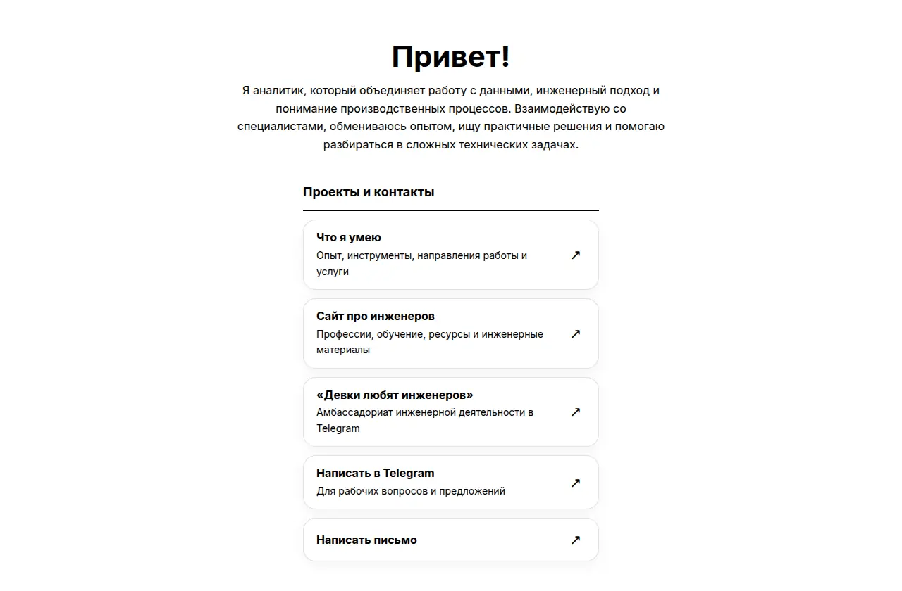
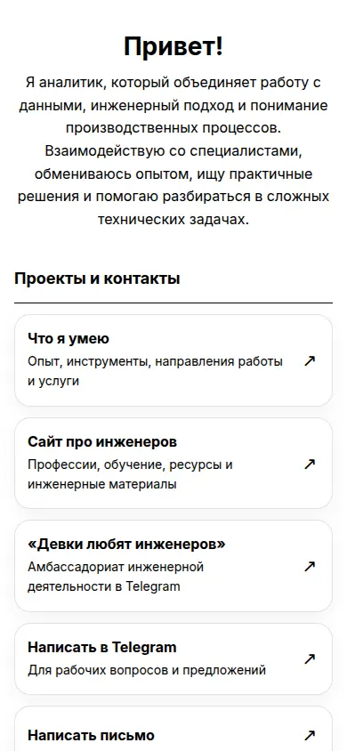

# Рабочая визитка

Компактная адаптивная страница с контактами и переключением светлой и тёмной темы. HTML / CSS / JavaScript; без сборки и зависимостей.

[**Открыть сайт**](https://vremennobeznika.github.io/visit_card/)

**Что посмотреть:** переключите тему, обновите страницу и проверьте сохранение выбора. Посмотрите расположение контактов на узком экране.

**Локальный запуск:** `python3 -m http.server 8000` → http://localhost:8000/.

## Скриншоты

Статический сайт: HTML, CSS и JavaScript без сборки и зависимостей.

## Файлы
- `index.html` — содержание страницы и ссылки.
- `style.css` — оформление, адаптивная сетка и светлая/тёмная темы.
- `script.js` — переключатель темы с сохранением выбора в браузере.

## Публикация через GitHub Pages
1. Создайте отдельный репозиторий на GitHub.
2. Загрузите в корень репозитория все три файла сайта.
3. Откройте **Settings → Pages**.
4. В разделе сборки выберите **Deploy from a branch**, ветку `main` и папку `/ (root)`.
5. Сохраните настройки и дождитесь публикации.

Все внешние ссылки уже прописаны в `index.html`. Для изменения текста или адресов отредактируйте этот файл.
