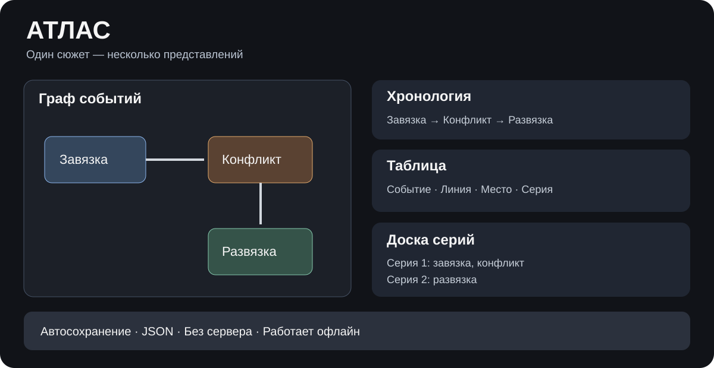

# АТЛАС — сценарная мастерская

Автономный визуальный редактор для разработки сериалов, фильмов и книг. Работает без регистрации, сервера, установки и сторонних библиотек.

## Запуск

[Открыть редактор](index.html) или скачать `index.html` и открыть в браузере. Встроенная «Тайна маяка» — полностью вымышленный учебный сюжет, не содержащий реальной истории автора.

## Возможности

- Интерактивный граф событий с направленными связями.
- Хронология, таблица и поиск по событиям.
- Карточки персонажей, сюжетные линии, планирование серий.
- Отмена и повтор изменений.
- Автосохранение в браузере, импорт и экспорт JSON.

## Конфиденциальность

Данные проекта сохраняются только в localStorage браузера и не отправляются на сервер. Публичная версия использует отдельный ключ хранилища `atlas-public-demo-v2` и не загружает проекты прежней версии. Не добавляйте в публичный репозиторий экспортированные JSON с личными данными.

## Ограничения

При очистке данных браузера проект может быть утрачен: регулярно экспортируйте JSON. Импорт проекта заменяет текущие данные, поэтому перед импортом сохраните резервную копию. Синхронизация между устройствами и совместное редактирование не предусмотрены.

## Проверка

Проверены в Chromium: запуск редактора, граф из восьми демонстрационных событий, перемещение карточки, отмена, таблица, экспорт JSON и отсутствие ошибок JavaScript при этих действиях. Длительная работа на старых устройствах не проверена.
